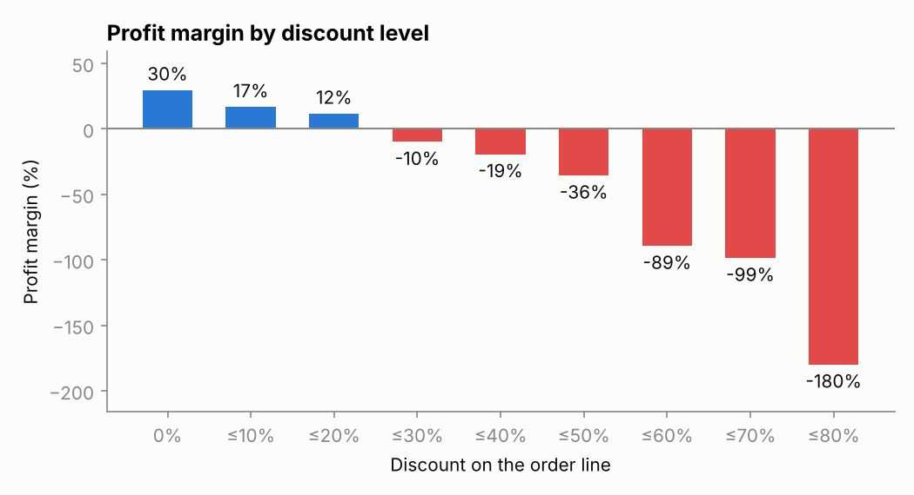
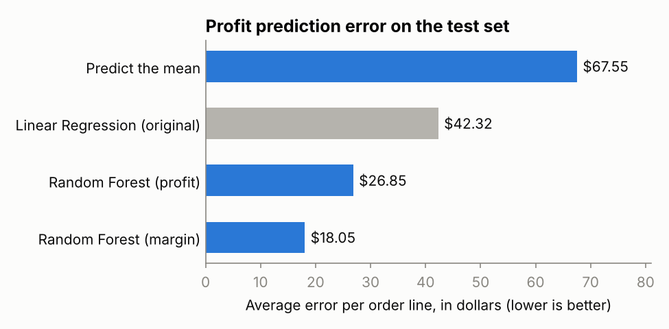
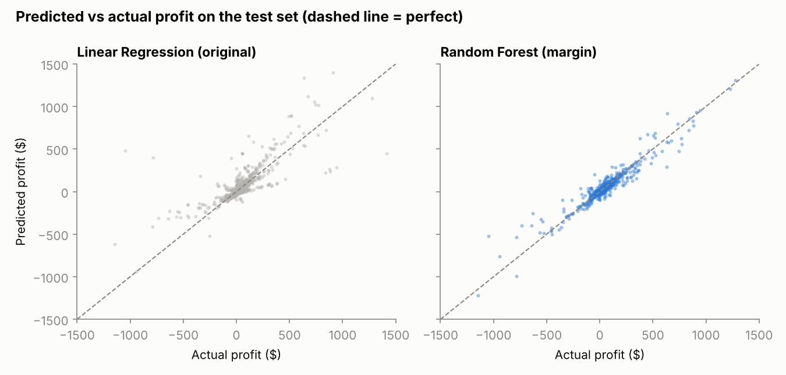
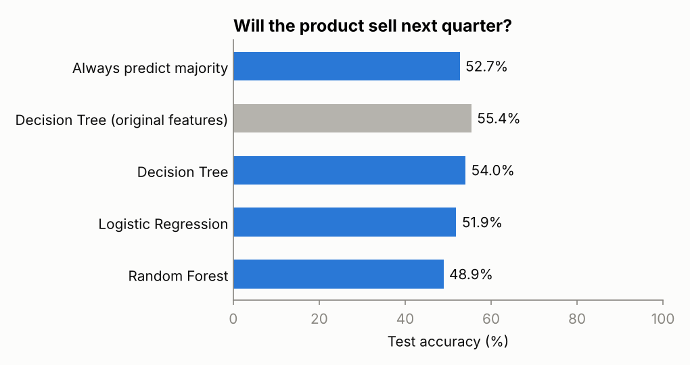
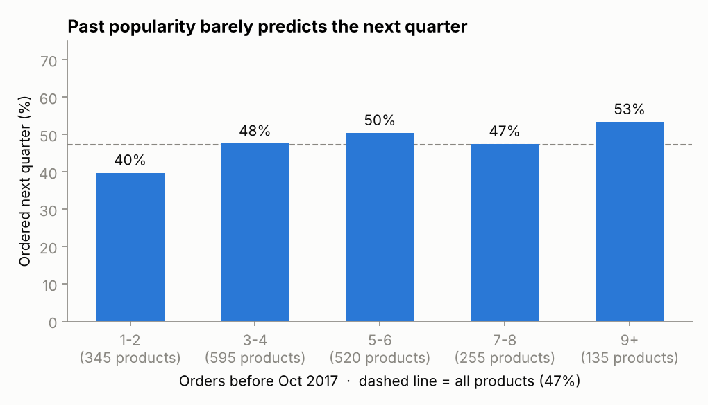

# Superstore Sales Analytics

Two machine learning tasks on a retail sales dataset: predicting the profit of each order line, and predicting whether a product will be ordered again next quarter.

I first built both models in RapidMiner for a course. This repository rebuilds them in Python with scikit-learn, compares them against the originals, and fixes the problems the rebuild uncovered. The original RapidMiner processes and results are kept in [`docs/rapidminer/`](docs/rapidminer/).

## Dataset

The [Sample Superstore dataset](https://public.tableau.com/app/learn/sample-data): 9,994 order lines from a US office supplies retailer, January 2014 to December 2017. Each row has the order and ship dates, customer segment, region, product category and sub-category, sales, quantity, discount, and profit.

Discounts are the biggest driver of profit. Every discount band above 20% loses money on average. Those 1,393 order lines (14% of the total) lost $135,000 combined, while the remaining lines earned $422,000.



## Part 1: Predicting profit

**Task:** predict the profit of an order line from its sales amount, quantity, discount, product category and sub-category, region, customer segment, and ship mode.

**Original version:** a linear regression in RapidMiner using Sales, Discount, Sales × Discount, and a flag for Office Supplies. RapidMiner reported a cross-validated RMSE of 118 ± 45. The Python replica of that model gets 121 ± 29, so the rebuild matches the original.

**What changed:**

1. **A better metric.** Profit ranges from −$6,600 to +$8,400, and RMSE squares each error, so a handful of extreme orders dominate it. Mean absolute error (MAE), the average dollar error per order line, is the headline metric here.
2. **More features and a non-linear model.** A random forest uses all the columns listed above, including sub-category, which decides most of a product's margin.
3. **Predicting margin instead of dollars.** The final model predicts profit margin (profit ÷ sales) and multiplies it by the sales amount. A 40% discount on binders has roughly the same margin whether the order is $10 or $10,000, so learning the margin lets the model reuse one pattern across all order sizes.

All models use an 80/20 train/test split, and models are compared using 5-fold cross-validation on the training set.

| Model | CV MAE | Test MAE | Test RMSE | Test R² |
|---|---|---|---|---|
| Predict the mean | $63.77 | $67.55 | $220.43 | 0.00 |
| Linear Regression (original) | $37.44 | $42.32 | $181.24 | 0.32 |
| Random Forest (profit) | $19.12 | $26.85 | $217.73 | 0.02 |
| **Random Forest (margin)** | **$14.09** | **$18.05** | **$119.08** | **0.71** |



The final model's average error is $18 per order line, less than half the original's $42. Its cross-validated R² is 0.95.

The test R² of 0.71 is lower than that because of a single order: the largest sale in the dataset ($22,638 of machines at a 50% discount, which lost $1,811). The random forest predicting dollars got this order completely wrong (+$6,036), which is why its test RMSE is no better than predicting the mean. Tree models can't extrapolate beyond the values they were trained on. The margin model handles this order much better, because a 50% discount on machines has a clear negative margin whatever the order size.



## Part 2: Predicting reorders

**Task:** for each product, predict whether it will be ordered again in the next quarter.

**Original version:** in RapidMiner, I aggregated the orders to one row per product, created a `Reorder_Flag` label, and trained a decision tree. It reached 65.3% cross-validated accuracy, while always guessing "not reordered" would have scored 56.8%.

**Problems found in the original:**

- **The numeric features were lost.** A "Numerical to Binominal" step converted total sales, total profit, and average discount into true/false values. Nearly every product came out "true" (1,829 of 1,835 for profit, for example), so the tree in practice only had ship mode and sub-category to learn from. The [statistics screenshot](docs/rapidminer/model2_statistics.png) shows this.
- **The label definition was lost.** The process file wasn't kept, so the exact rule behind `Reorder_Flag` is unknown. Because the label and the features were computed from the same orders, the 65% result can't be checked.

**Rebuilt version:** the task is redefined as a proper forecast with a time cutoff on October 1, 2017.

- **Features** come only from orders **before** the cutoff: number of orders and customers, total quantity, sales and profit, average discount and unit price, days since the first and last order, orders in the past year, main ship mode, category, and sub-category.
- **Label:** whether the product was ordered **between October and December 2017**.

This gives 1,850 products, 47.3% of which were ordered in the final quarter. That's close to the original's 1,835 products and 43% reorder rate. The models use an 80/20 stratified split and 5-fold cross-validation.

| Model | CV ROC-AUC | Test Accuracy | Test ROC-AUC |
|---|---|---|---|
| Always predict majority | 0.500 | 52.7% | 0.500 |
| Decision Tree (original features) | 0.559 ± 0.034 | 55.4% | 0.559 |
| Decision Tree | 0.527 ± 0.030 | 54.0% | 0.531 |
| Logistic Regression | 0.565 ± 0.032 | 51.9% | 0.517 |
| Random Forest | 0.557 ± 0.037 | 48.9% | 0.499 |



**Result: no model meaningfully beats guessing.** A ROC-AUC of 0.5 means random, and all the models land between 0.50 and 0.56. The differences between them are within the spread across cross-validation folds. With only 370 products in the test set, a few points of accuracy either way is noise.

This is a property of the data, not of the models. The chart below shows the only pattern there is: products that sold more often in the past are slightly more likely to sell next quarter, rising from 40% to 53%. How recently a product last sold makes no difference at all. Superstore is a synthetic teaching dataset, and its repeat orders appear to be close to random.



The takeaway is that the original 65% result most likely came from how the label was defined, not from real predictive power. Once features and label come from separate time periods, there is very little left to predict.

## Project structure

```
├── data/superstore.csv       # raw dataset
├── src/
│   ├── data.py               # loading, and the product-level reorder table
│   ├── profit_model.py       # Part 1
│   ├── reorder_model.py      # Part 2
│   └── style.py              # shared chart styling
├── reports/
│   ├── metrics_profit.json   # all metrics from the last run
│   ├── metrics_reorder.json
│   └── figures/              # charts used in this README
├── docs/rapidminer/          # screenshots of the original RapidMiner work
└── requirements.txt
```

## How to run

```bash
pip install -r requirements.txt
python src/profit_model.py
python src/reorder_model.py
```

Each script prints its comparison table, regenerates its figures, and writes its metrics file. Both together take about a minute.

## Possible improvements

- **Profit:** add product-level features such as a product's historical average margin, and cap or model the largest orders separately.
- **Reorders:** test the same setup on a real retail dataset (for example the UCI Online Retail dataset), where repeat purchasing behavior is real.
